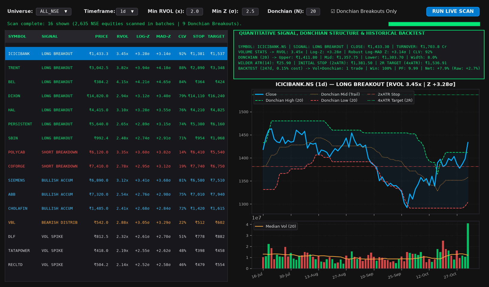
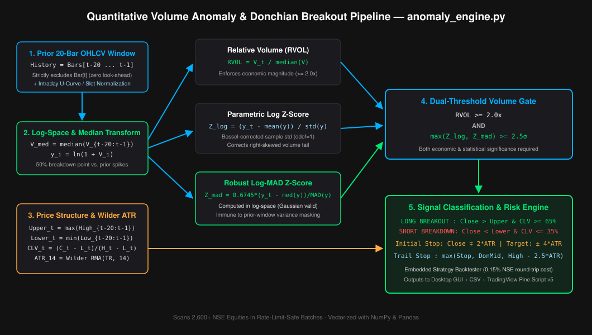
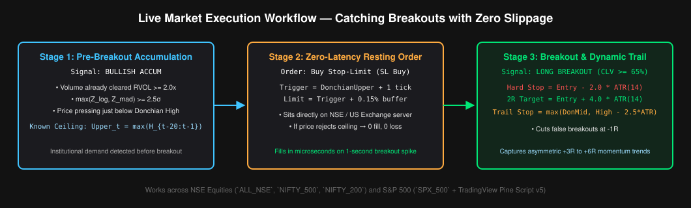

# NSE & S&P 500 Volume-Breakout Screener & Strategy Engine

A multithreaded quantitative volume-breakout screener and backtesting engine for the **Indian Stock Market (NSE — 2,635+ listed equities)** and the **US S&P 500 (`SPX_500`)**. It scans equity universes in rate-limit-safe batches, combining **outlier-resistant log-volume statistics (Parametric Log-Z, Non-Parametric Log-MAD Z, and Benjamini-Hochberg FDR calibration)** with **1-bar shifted Donchian Channels, Close Location Value (CLV), Wilder's ATR(14) risk sizing, and a Next-Bar-Open Strategy Backtester**.

Includes both a **dark-themed Python Desktop Terminal (`gui.py`)** for market-wide screening and **TradingView Pine Script v5 Strategies (`pinescript/`)** for chart-level execution and backtesting on NSE and SPX/US equities.



---

## Key Features

* **Multi-Market Universe Coverage (`ALL_NSE`, `NIFTY_500`, `NIFTY_200`, `SPX_500`)**: Dynamically fetches active NSE equities from `EQUITY_L.csv` (with a configurable default `₹1 Cr` minimum median daily turnover filter to exclude illiquid micro-caps) as well as **`^GSPC`, `SPY`, and 503 S&P 500 US constituents** (`SPX_500`), formatting prices and turnover in **`₹` (`₹ Cr`)** or **`$` (`$M`)**.
* **Calibrated Dual-Z Volume Engine**: Uses **Parametric Log-Volume Z-Score** (`ddof=1`) by default and promotes the **Non-Parametric Log-MAD Modified Z-Score** (Iglewicz & Hoaglin, 1993 in log-space) when a prior outlier in the 20-bar window inflates sample standard deviation (`Z_mad > 1.4 × Z_log`, recovering masked breakouts while reducing false positives by ~25% compared to an uncalibrated `max(Z_log, Z_mad)` rule). Computes predictive Student-`t (t = Z_log / sqrt(1 + 1/n), df = n - 1)` p-values and full-family **Benjamini-Hochberg False Discovery Rate (`fdr_q`)** across all tested symbols.
* **Directional Price Structure (Shifted Donchian + CLV)**: Evaluates volume surges against a **1-bar shifted 20-period Donchian Channel** (`[t-20 ... t-1]`) and **Close Location Value (`CLV >= 0.65`)** to distinguish confirmed breakouts (`LONG BREAKOUT` / `SHORT BREAKDOWN`) from upper-wick bull traps.
* **Intraday & Partial-Session Volume Normalization**:
  * **Intraday Same-Slot Matching (`15m`, `1h`)**: Converts timestamps to each exchange's native timezone (`Asia/Kolkata` for `.NS`, `America/New_York` for US) and matches current volume against historical bars from the **exact same `(hour, minute)` slot** in both Python and Pine Script.
  * **Partial-Session Projection (`1d`)**: After 10:00 AM IST (at least 45 minutes into the NSE session), scales in-progress daily volume using a parametric U-curve session approximation (`t + 0.14 * sin(2πt)`).
* **Realistic Next-Open & Risk-Sized Backtester**: Evaluates signals at bar `i` (using same-slot baselines on intraday timeframes and rolling baselines on daily bars) and fills both entries and `DonchianMid` breakdown exits at the **next bar's Open (`Open[i+1]`)**. Sizes positions via **1% Fixed-Fractional Equity Risk** divided by the `2× Wilder ATR(14)` stop distance, enforces conservative **stop-first precedence** when optional `4×ATR` profit targets are enabled, deducts **`0.25%` round-trip NSE delivery costs** plus **`0.10 × ATR` stop-fill slippage**, and compares against raw unfiltered Donchian breakouts.
* **TradingView Pine Script v5 Strategies**: Includes **`nse_anomaly_donchian.pine`** (with intraday same-slot volume normalization, `biased=false` sample std, `barstate.isconfirmed` anti-repainting, and automatic `NIFTY1!`/`BANKNIFTY1!` futures volume proxy) and **`spx_anomaly_donchian.pine`** (calibrated for S&P 500 index aggregation with an intraday-only Session VWAP filter and automatic `AMEX:SPY` volume proxy).

---

## Quantitative Methodology



Trading volume is **strictly positive and right-skewed (approximately log-normal)** — a naive percentage-change or simple moving average (SMA) baseline is easily distorted by prior spikes. This engine pairs log-space statistics with price-structure confirmation:

| Metric | Formula | Quantitative Purpose |
|---|---|---|
| **Volume Baseline** | `Med_V = median(V_{t-20} ... V_{t-1})` | Outlier-resistant baseline (50% breakdown point), strictly excluding bar `t` |
| **Relative Volume (RVOL)** | `RVOL_t = V_t / Med_V` | Enforces **economic magnitude** vs. typical trading activity |
| **Parametric Log Z-Score** | `Z_log = (ln(1 + V_t) - μ_log) / σ_log` | Corrects for volume's log-normal skewness using Bessel-corrected sample std (`ddof=1`) |
| **Robust Log-MAD Z-Score** | `Z_mad = 0.6745 × (ln(1 + V_t) - Med_log) / MAD_log` | Promoted when `Z_mad > 1.4 × Z_log` to prevent **variance masking** from a prior spike in the window |
| **Predictive Student-t & FDR** | `t = Z_log / sqrt(1 + 1/n)`, `q_i = min_{k >= i} (p_k × M / k)` | Prediction-scaled Student-`t (df = n - 1)` p-value & full-family Benjamini-Hochberg `q`-value across `M` tested symbols |
| **Historical Median Turnover** | `Turnover_Cr = median(V_{t-20:t-1} × C_{t-20:t-1}) / 10^7` | Outlier-resistant median daily traded value in `₹ Crores` (filters illiquid micro-caps below `₹1 Cr`) |
| **Shifted Donchian Channel** | `Upper_t = max(H_{t-20...t-1})`, `Lower_t = min(L_{t-20...t-1})` | Strictly shifted by 1 bar so `Close_t > Upper_t` confirms absorption of prior 20-bar resistance |
| **Close Location Value (CLV)** | `CLV_t = (Close_t - Low_t) / (High_t - Low_t)` | Rejects upper-wick rejection candles (requires `CLV_t >= 0.65` for long breakouts) |
| **Wilder's ATR(14)** | `ATR_t = (1/14) × TR_t + (13/14) × ATR_{t-1}` | Sizes 1% fixed-fractional risk position and sets initial Stop (`Entry - 2×ATR`) & Target (`Entry + 4×ATR`) |

**Signal Classification Rules:**
* **Volume Anomaly Gate:** `RVOL_t >= 2.0x` **AND** `Effective_Z >= 2.5σ`
* **Long Breakout (`LONG BREAKOUT`):** `Close_t > Upper_t` **AND** `CLV_t >= 0.65` **AND** `Close_t >= Open_t`
* **Short Breakdown (`SHORT BREAKDOWN`):** `Close_t < Lower_t` **AND** `CLV_t <= 0.35` **AND** `Close_t <= Open_t`
* **Pre-Breakout Accumulation (`BULLISH ACCUM`):** Volume Gate passed **AND** `Close_t >= DonchianMid_t` **AND** `CLV_t >= 0.65`

---

## Discretionary Execution Workflow



1. **Next-Bar-Open Execution (Backtested Mode)**: When a stock closes above `DonchianUpper` with confirmed volume (`LONG BREAKOUT`), entry is modeled at the **next bar's Open**, with position size scaled so the `2.0 × ATR(14)` stop equals `1.0%` of account equity. Intrabar exits trigger on the `2.5 × ATR(14)` Chandelier trailing stop (with `0.10 × ATR` adverse slippage), while a bar close below `DonchianMid` exits at the **next bar's Open**.
2. **Pre-Breakout Stop-Limit Workflow (Discretionary Mode)**: Because `DonchianUpper_t = max(High_{t-20 ... t-1})` is fixed for the duration of bar `t`, traders monitoring `BULLISH ACCUM` setups can place a resting **Buy Stop-Limit (`SL` Buy)** order at `DonchianUpper + 1 tick` via their broker terminal.

---

## Empirical Validation & Benchmark Results

Tested on **19,751 real daily stock-bars** (`80` NSE equities from `NIFTY_200` over 1 trailing year via `yfinance`, `auto_adjust=True`) under the **Next-Bar-Open, 1% Fixed-Fractional Risk** backtest model (`0.25%` round-trip NSE delivery cost + `0.10 × ATR` stop-fill slippage + `₹1 Cr` minimum median historical turnover):

| Strategy Variant | Total Trades (80 Stocks, 1Y) | Win Rate % | False-Breakout Reduction | Mean Portfolio Return / Stock |
| :--- | :---: | :---: | :---: | :---: |
| **Raw Unfiltered 20-Day Donchian Breakout** | `342` | `29.2%` | Baseline | `-0.80%` |
| **Volume-Confirmed Donchian (`RVOL >= 2.0x`, `Z >= 2.5σ`, `CLV >= 65%`)** | **`123`** | **`36.6%` (`+7.4%`)** | **`-64.0%`** | **`+0.09%`** |

**Statistical Calibration Checks (`test_suite.py` & Monte Carlo Null Simulations):**
* **Predictive Student-`t` Tail Uniformity ($N=20, df=19$):** Across 2,000 independent log-normal noise series ($\sigma = 0.3$), $P(p \le 0.01) = 1.00\%$ using $t = Z_{\text{log}} / \sqrt{1 + 1/n}$.
* **Anti-Masking Gate ($\sigma = 0.5$ log-normal noise vs. $55\times$ prior spike):** Reduces false-pass rate by **24.7%** compared to naive $\max(Z_{\text{log}}, Z_{\text{MAD}})$ (`1.77%` vs. `2.35%`) while maintaining **100% detection** when a $55\times$ prior earnings spike contaminates the 20-bar baseline window.

---

## Setup & Installation

```bash
git clone https://github.com/MrVenomWolf/NSE-Trade-Anomaly-Detector.git
cd NSE-Trade-Anomaly-Detector
pip install -r requirements.txt
```

### Required Packages (`requirements.txt`)
* `pandas>=2.2.0,<4.0.0` — Vectorized rolling Donchian channels & OHLCV time-series handling
* `numpy>=1.26.0,<3.0.0` — Log-space Z-score, MAD, and Wilder ATR array computations
* `yfinance>=0.2.50,<2.0.0` — Batched multi-ticker OHLCV fetching (`auto_adjust=True`)
* `matplotlib>=3.8.0,<4.0.0` — Dark-themed price, Donchian channel, and volume charting
* `requests>=2.31.0,<3.0.0` — Dynamic NSE (`EQUITY_L.csv`) and S&P 500 universe fetching

---

## Configuration (`config.py`)

| Parameter | Default | Description |
|---|---|---|
| `MIN_Z_SCORE` | `2.5` | Minimum log-normalized Z-score threshold (`~99.4th` percentile) |
| `MIN_RVOL` | `2.0` | Minimum relative volume multiplier vs. 20-bar rolling median |
| `BASELINE_WINDOW` | `20` | Historical lookback window (`W`) for volume baseline & Z-score |
| `DONCHIAN_WINDOW` | `20` | Prior `N` bars (`[t-N ... t-1]`) for shifted Donchian Upper/Lower bands |
| `ATR_PERIOD` | `14` | Wilder's Average True Range lookback period (`RMA`, `alpha = 1/14`) |
| `ATR_STOP_MULT` | `2.0` | Initial hard stop-loss distance (`2.0 × ATR`) |
| `ATR_TARGET_MULT` | `4.0` | Initial `2R` take-profit distance (`4.0 × ATR`) |
| `MIN_CLOSE_STRENGTH` | `0.65` | Minimum Close Location Value (`CLV >= 65%` for long breakouts) |
| `MIN_MEDIAN_TURNOVER_CR` | `1.0` | Minimum 20-day median daily turnover (`₹1 Cr`) for daily NSE scans |
| `NSE_ROUND_TRIP_COST_PCT` | `0.25` | Round-trip transaction cost (`0.25%`) deducted per backtested trade |
| `STOP_SLIPPAGE_ATR_FRAC` | `0.10` | Adverse stop-fill slippage (`0.10 × ATR`) deducted on stop exits |
| `RISK_PER_TRADE_PCT` | `1.0` | Fixed-fractional portfolio equity (`1.0%`) risked per backtested trade |

---

## Running the Application

### 1. Quantitative Desktop Terminal (Recommended)
```bash
python gui.py
```
* Select your **Universe** (`ALL_NSE`, `NIFTY_500`, `NIFTY_200`, or `SPX_500`) and **Timeframe** (`15m`, `1h`, or `1d`).
* Click **RUN LIVE SCAN** (and toggle **Donchian Breakouts Only** to filter directly to confirmed breakouts).
* Click any flagged stock in the table to inspect its **Donchian Channel overlay**, **2xATR Stop / 4xATR Target lines**, **20-bar Median Volume Baseline**, and **Next-Open Risk-Sized Strategy Backtest**.

### 2. Command Line Scanner (CLI)
```bash
# Scan all liquid NSE stocks on daily candles
python main.py

# Scan S&P 500 (^GSPC, SPY + 503 US equities) on daily or intraday candles
python main.py --universe SPX_500 --interval 1d

# Scan Nifty 200 on 15-minute intraday candles for confirmed Donchian breakouts only
python main.py --universe NIFTY_200 --interval 15m --breakouts-only

# Custom thresholds
python main.py --rvol 2.5 --z-score 3.0
```

### 3. TradingView Pine Script v5 Strategies (NSE & SPX / US Markets)
* **For NSE Stocks & Nifty/BankNifty Options:** Copy `pinescript/nse_anomaly_donchian.pine` *(includes automatic `NSE:NIFTY1!` / `NSE:BANKNIFTY1!` futures volume proxy when loaded on cash index charts, plus intraday same-slot normalization and quick take-profit targets)*.
* **For S&P 500 (`SPX` / `SPY` / `ES1!`) & US Stocks:** Copy `pinescript/spx_anomaly_donchian.pine` *(includes automatic `AMEX:SPY` ETF volume proxy when loaded on the cash `SPX` index)*.
1. In TradingView, open the **Pine Editor**, clear any existing template (`Ctrl+A` then `Backspace`), paste the script, and click **Add to chart**.
2. Open TradingView's **Strategy Tester** tab to inspect backtest metrics across `5m`, `15m`, `1H`, or `1D` timeframes.

### 4. Automated Test Suite
```bash
python test_suite.py
```

---

## Project Architecture

```text
├── config.py                        <- Thresholds & lazy-loaded universe fetcher (ALL_NSE / Nifty 500 / Nifty 200 / SPX_500)
├── anomaly_engine.py                <- Vectorized engine (Log-Z, Log-MAD Z, Student-t FDR, Donchian, CLV, Wilder ATR, Backtester)
├── alerts.py                        <- Console reporting & 17-column CSV alert logger
├── main.py                          <- CLI entry point with batched scanning, BH-FDR calibration & signal prioritization
├── gui.py                           <- Non-blocking dark Tkinter + Matplotlib quantitative terminal
├── test_suite.py                    <- Unit & integration tests verifying math, timezones, risk sizing, and pipeline
├── .github/workflows/tests.yml      <- GitHub Actions CI pipeline running test_suite.py on push/PR
├── docs/
│   ├── dashboard.png                <- Quantitative Desktop Terminal preview
│   ├── methodology_diagram.svg      <- 5-stage statistical & price-structure pipeline diagram
│   └── execution_workflow.svg       <- Execution & ATR risk-sizing workflow diagram
├── data_sources/
│   └── equities.py                  <- Rate-limit-resistant batched OHLCV fetcher & in-memory DataFrame cache
└── pinescript/
    ├── nse_anomaly_donchian.pine    <- TradingView Pine Script v5 Strategy for NSE equities & Nifty options
    └── spx_anomaly_donchian.pine    <- TradingView Pine Script v5 Strategy for SPX / SPY / US markets
```

---

## Assumptions & Limitations

1. **Data Feed Latency (`yfinance`)**: The Python scanner uses batched HTTP polling via Yahoo Finance (`15m`, `1h`, `1d` bars), which is designed for bar-close screening rather than sub-second tick or order-book surveillance. For tick-level alerts, use the included TradingView Pine Script v5 strategies or swap `data_sources/equities.py` for a broker WebSocket feed.
2. **Survivorship Bias**: Universe lists (`EQUITY_L.csv`, `ind_nifty500list.csv`, and S&P 500 constituents) reflect current index/exchange membership and do not include historically delisted securities.
3. **Single-Ticker Sample Size**: A strict dual-threshold volume + 20-bar Donchian breakout filter fires infrequently on any single stock (typically 1–5 trades per year on daily bars). Per-ticker backtest numbers shown in the GUI are descriptive context for that instrument rather than a standalone statistical proof of alpha.
4. **Transaction Costs & Circuit Limits**: The Python backtester deducts `0.25%` round-trip costs (approximating NSE delivery STT of `0.1%` per side plus brokerage/GST/stamp duty) and `0.10 × ATR` stop-fill slippage, and defaults to a `₹1 Cr` minimum median daily turnover filter. Illiquid micro-caps subject to NSE upper/lower price circuits (`ASM`/`GSM` segments) can experience larger fill slippage in live trading.

---

## Disclaimer

Built for **educational and quantitative research purposes only**. Statistical volume anomalies and Donchian breakouts represent quantitative filtering rules and historical backtest simulations — they do not constitute financial advice.
