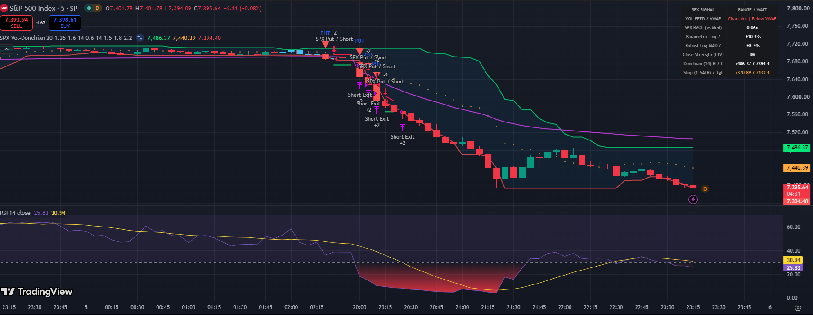

# NSE & S&P 500 Volume-Breakout Screener & Strategy Engine

A multithreaded quantitative volume-breakout screener and backtesting engine for the **Indian Stock Market (NSE — 2,635+ listed equities)** and the **US S&P 500 (`SPX_500`)**. It scans equity universes in rate-limit-safe batches, combining **outlier-resistant log-volume statistics (Parametric Log-Z, Non-Parametric Log-MAD Z, and SciPy Student-`t` Benjamini-Hochberg FDR)** with **1-bar shifted Donchian Channels, Close Location Value (CLV), Wilder's ATR(14) risk sizing, and a Long-Only Next-Bar-Open Strategy Backtester**.

Includes both a **dark-themed Python Desktop Terminal (`gui.py`)** for market-wide screening and **TradingView Pine Script v5 Strategies (`pinescript/`)** for chart-level backtesting and alerts on NSE and SPX/US equities.



---

## Key Features

* **Multi-Market Universe Coverage (`ALL_NSE`, `NIFTY_500`, `NIFTY_200`, `SPX_500`)**: Dynamically fetches active NSE equities from `EQUITY_L.csv` (with a configurable default `₹1 Cr` minimum median daily turnover filter to exclude illiquid micro-caps) as well as **`^GSPC`, `SPY`, and 503 S&P 500 US constituents** (`SPX_500`), formatting prices and turnover in **`₹` (`₹ Cr`)** or **`$` (`$M`)**.
* **Dual-Z Volume Engine with Exact SciPy Student-`t` Significance**:
  * Computes the **Parametric Log-Volume Z-Score** (`ddof=1`) and promotes the **Non-Parametric Log-MAD Modified Z-Score** (Iglewicz & Hoaglin, 1993 in log-space) as a heuristic anti-masking screen when a prior outlier in the 20-bar window inflates sample standard deviation (`Z_mad > 1.4 × Z_log`).
  * Evaluates exact one-sided predictive Student-`t` p-values (`scipy.stats.t.sf(Z_log / sqrt(1 + 1/n), df = n - 1)`) from the conventional parametric test and computes full-family **Benjamini-Hochberg False Discovery Rate (`fdr_q`)** with conservative tie-group ranking across all tested symbols.
* **Directional Price Structure (Shifted Donchian + CLV)**: Evaluates volume surges against a **1-bar shifted 20-period Donchian Channel** (`[t-20 ... t-1]`) and **Close Location Value (`CLV >= 0.65`)** to distinguish confirmed breakouts (`LONG BREAKOUT` / `SHORT BREAKDOWN`) from upper-wick bull traps.
* **Intraday & Partial-Session Volume Normalization**:
  * **Intraday Same-Slot Matching (`15m`, `1h`)**: Converts timestamps to each exchange's native timezone (`Asia/Kolkata` for `.NS`, `America/New_York` for US) and matches current volume against historical bars from the **exact same `(hour, minute)` slot** in both Python and Pine Script.
  * **Partial-Session Projection (`1d`)**: After 10:00 AM IST (at least 45 minutes into the NSE session), scales in-progress daily volume using a parametric U-curve session approximation (`t + 0.14 * sin(2πt)`).
* **Shared-Signal Long-Only Backtester**: Both the live screener (`find_anomalies`) and the historical backtester (`backtest_donchian_volume`) call the same `_evaluate_bar_volume_and_turnover` and `classify_signal` functions. The backtester evaluates **long-only breakout trades**, fills entries and `DonchianMid` breakdown exits at the **next bar's Open (`Open[i+1]`)**, sizes positions via **1% Fixed-Fractional Equity Risk** divided by the `2× Wilder ATR(14)` stop distance, tracks **marked-to-market unrealized drawdown** on every bar while positions are open, trails winners with a `2.5× ATR(14)` Chandelier stop (plus optional `4× ATR` target mode with conservative stop-first precedence), and deducts **`0.25%` round-trip NSE delivery costs** plus **`0.10 × ATR` stop-fill slippage**.
* **Strict OHLCV Validation**: Rejects malformed or corrupted bars (`High < Low`, `High < max(O,C)`, `Low > min(O,C)`, non-positive prices, or negative volume) rather than silently clamping them, reporting rejected bar counts in `LAST_SCAN_STATS`.

---

## Quantitative Methodology


Trading volume is **strictly positive and right-skewed (approximately log-normal)** — a naive percentage-change or simple moving average (SMA) baseline is easily distorted by prior spikes. This engine pairs log-space statistics with price-structure confirmation:

| Metric | Formula | Quantitative Purpose |
|---|---|---|
| **Volume Baseline** | `Med_V = median(V_{t-20} ... V_{t-1})` | Outlier-resistant baseline (50% breakdown point), strictly excluding bar `t` |
| **Relative Volume (RVOL)** | `RVOL_t = V_t / Med_V` | Enforces **economic magnitude** vs. typical trading activity |
| **Parametric Log Z-Score** | `Z_log = (ln(1 + V_t) - μ_log) / σ_log` | Corrects for volume's log-normal skewness using Bessel-corrected sample std (`ddof=1`) |
| **Heuristic Log-MAD Z-Score** | `Z_mad = 0.6745 × (ln(1 + V_t) - Med_log) / MAD_log` | Promoted when `Z_mad > 1.4 × Z_log` as a heuristic screen to prevent **variance masking** from a prior spike |
| **Parametric Student-t & FDR** | `p = t.sf(Z_log / sqrt(1 + 1/n), df=n-1)` | Exact `scipy.stats.t.sf` predictive p-value & conservative tie-grouped Benjamini-Hochberg `q`-value |
| **Historical Median Turnover** | `Turnover_Cr = median(V_{t-20:t-1} × C_{t-20:t-1}) / 10^7` | Outlier-resistant median daily traded value in `₹ Crores` (filters illiquid micro-caps below `₹1 Cr`) |
| **Shifted Donchian Channel** | `Upper_t = max(H_{t-20...t-1})`, `Lower_t = min(L_{t-20...t-1})` | Strictly shifted by 1 bar so `Close_t > Upper_t` confirms absorption of prior 20-bar resistance |
| **Close Location Value (CLV)** | `CLV_t = (Close_t - Low_t) / (High_t - Low_t)` | Rejects upper-wick rejection candles (requires `CLV_t >= 0.65` for long breakouts) |
| **Wilder's ATR(14)** | `ATR_t = (1/14) × TR_t + (13/14) × ATR_{t-1}` | Sizes 1% fixed-fractional risk position and sets initial Stop (`Entry - 2×ATR`) & Reference Target (`Entry + 4×ATR`) |

**Signal Classification Rules:**
* **Volume Anomaly Gate:** `RVOL_t >= 2.0x` **AND** `Effective_Z >= 2.5σ` **AND** `Turnover_Cr >= 1.0` (on daily NSE bars)
* **Long Breakout (`LONG BREAKOUT`):** `Close_t > Upper_t` **AND** `CLV_t >= 0.65` **AND** `Close_t >= Open_t`
* **Short Breakdown (`SHORT BREAKDOWN`):** `Close_t < Lower_t` **AND** `CLV_t <= 0.35` **AND** `Close_t <= Open_t` *(scanner alert label; Python backtester is long-only)*
* **Pre-Breakout Accumulation (`BULLISH ACCUM`):** Volume Gate passed **AND** `Close_t >= DonchianMid_t` **AND** `CLV_t >= 0.65`

---

## Backtest & Risk-Sizing Architecture


1. **Shared Signal Evaluation (`Bar i` Close)**: Both the live scanner and historical backtester evaluate the exact same `_evaluate_bar_volume_and_turnover` and `classify_signal` criteria after bar `i` closes.
2. **Next-Bar-Open Entry & 1% Fixed-Fractional Sizing (`Bar i+1` Open)**: Confirmed `LONG BREAKOUT` signals fill at `Open_{i+1}`, with position weight set to `min(1.0, 0.01 / (Risk / Entry))` where `Risk = max(0.01 * Entry, 2.0 * ATR_i)`.
3. **Trailing Exit & Cost Deduction**: Positions exit intrabar on the `2.5 × ATR(14)` Chandelier stop (with `0.10 × ATR` adverse slippage) or at the **next bar's Open** following a bar close below `DonchianMid`. An optional `use_target=True` mode also tests exiting at the `4.0 × ATR` (`2R`) target with conservative **stop-first precedence** when both levels are touched on the same bar.

---

## Empirical Validation & Benchmark Results

Tested on **19,751 real daily stock-bars** (`80` NSE equities from `NIFTY_200` over 1 trailing year via `yfinance`, `auto_adjust=True`) under the **Long-Only, Next-Bar-Open, 1% Fixed-Fractional Risk** backtest model (`0.25%` round-trip NSE delivery cost + `0.10 × ATR` stop-fill slippage + `₹1 Cr` minimum median historical turnover):

| Strategy Variant | Total Trades (80 Stocks, 1Y) | Win Rate % | False-Breakout Reduction | Mean Portfolio Return / Stock |
| :--- | :---: | :---: | :---: | :---: |
| **Raw Unfiltered 20-Day Donchian Breakout** | `342` | `29.2%` | Baseline | `-0.80%` |
| **Volume-Confirmed Donchian (`use_target=False`, Chandelier + Mid Trail)** | **`123`** | **`36.6%` (`+7.4%`)** | **`-64.0%`** | **`+0.09%`** |
| **Volume-Confirmed Donchian (`use_target=True`, `4×ATR` Target Cap)** | **`126`** | **`37.3%` (`+8.1%`)** | **`-63.2%`** | **`-0.01%`** |

**Statistical Calibration Checks (`test_suite.py` & Monte Carlo Null Simulations):**
* **Exact `scipy.stats.t.sf` Predictive Tail Uniformity ($N=20, df=19$):** Across 2,000 independent log-normal noise series ($\sigma = 0.3$), $P(p \le 0.01) = 1.00\%$ using $t = Z_{\text{log}} / \sqrt{1 + 1/n}$.
* **Anti-Masking Heuristic Gate ($\sigma = 0.5$ log-normal noise vs. $55\times$ prior spike):** Reduces false-pass rate by **24.7%** compared to naive $\max(Z_{\text{log}}, Z_{\text{MAD}})$ (`1.77%` vs. `2.35%`) while maintaining **100% detection** when a $55\times$ prior earnings spike contaminates the 20-bar baseline window.

---

## Setup & Installation

```bash
git clone https://github.com/MrVenomWolf/Argus.git
cd Argus
pip install -r requirements.txt
```

### Required Packages (`requirements.txt`)
* `pandas>=2.2.0,<4.0.0` — Vectorized rolling Donchian channels & OHLCV time-series handling
* `numpy>=1.26.0,<3.0.0` — Log-space Z-score, MAD, and Wilder ATR array computations
* `scipy>=1.11.0,<2.0.0` — Exact Student-`t` survival function (`scipy.stats.t.sf`) for predictive p-values
* `yfinance>=0.2.50,<2.0.0` — Batched multi-ticker OHLCV fetching (`auto_adjust=True`)
* `matplotlib>=3.8.0,<4.0.0` — Dark-themed price, Donchian channel, and volume charting
* `requests>=2.31.0,<3.0.0` — Dynamic NSE (`EQUITY_L.csv`) and S&P 500 universe fetching

---

## Configuration (`config.py`)

| Parameter | Default | Description |
|---|---|---|
| `MIN_Z_SCORE` | `2.5` | Minimum log-normalized Z-score threshold (`~99.4th` percentile) |
| `MIN_RVOL` | `2.0` | Minimum relative volume multiplier vs. 20-bar rolling median |
| `BASELINE_WINDOW` | `20` | Historical lookback window (`W`) for volume baseline & Z-score |
| `DONCHIAN_WINDOW` | `20` | Prior `N` bars (`[t-N ... t-1]`) for shifted Donchian Upper/Lower bands |
| `ATR_PERIOD` | `14` | Wilder's Average True Range lookback period (`RMA`, `alpha = 1/14`) |
| `ATR_STOP_MULT` | `2.0` | Initial hard stop-loss distance (`2.0 × ATR`) |
| `ATR_TARGET_MULT` | `4.0` | Reference `2R` target distance (`4.0 × ATR`, active in backtester when `use_target=True`) |
| `MIN_CLOSE_STRENGTH` | `0.65` | Minimum Close Location Value (`CLV >= 65%` for long breakouts) |
| `MIN_MEDIAN_TURNOVER_CR` | `1.0` | Minimum 20-day median daily turnover (`₹1 Cr`) for daily NSE scans & backtests |
| `NSE_ROUND_TRIP_COST_PCT` | `0.25` | Round-trip transaction cost (`0.25%`) deducted per backtested trade |
| `STOP_SLIPPAGE_ATR_FRAC` | `0.10` | Adverse stop-fill slippage (`0.10 × ATR`) deducted on stop exits |
| `RISK_PER_TRADE_PCT` | `1.0` | Fixed-fractional portfolio equity (`1.0%`) risked per backtested trade |

---

## Running the Application

### 1. Quantitative Desktop Terminal (Recommended)
```bash
python gui.py
```
* Select your **Universe** (`ALL_NSE`, `NIFTY_500`, `NIFTY_200`, or `SPX_500`) and **Timeframe** (`15m`, `1h`, or `1d`).
* Click **RUN LIVE SCAN** (and toggle **Donchian Breakouts Only** to filter directly to confirmed breakouts).
* Click any flagged stock in the table to inspect its **Donchian Channel overlay**, **2xATR Stop / 4xATR Target lines**, **20-bar Median Volume Baseline**, and **Long-Only Next-Open Strategy Backtest**.

### 2. Command Line Scanner (CLI)
```bash
# Scan all liquid NSE stocks on daily candles
python main.py

# Scan S&P 500 (^GSPC, SPY + 503 US equities) on daily or intraday candles
python main.py --universe SPX_500 --interval 1d

# Scan Nifty 200 on 15-minute intraday candles for confirmed Donchian breakouts only
python main.py --universe NIFTY_200 --interval 15m --breakouts-only

# Custom thresholds
python main.py --rvol 2.5 --z-score 3.0
```

### 3. TradingView Pine Script v5 Strategies (NSE & SPX / US Markets)
* **For NSE Stocks & Nifty/BankNifty Options:** Copy `pinescript/nse_anomaly_donchian.pine` *(includes automatic `NSE:NIFTY1!` / `NSE:BANKNIFTY1!` futures volume proxy when loaded on cash index charts, plus intraday same-slot normalization)*.
* **For S&P 500 (`SPX` / `SPY` / `ES1!`) & US Stocks:** Copy `pinescript/spx_anomaly_donchian.pine` *(calibrated for S&P 500 index aggregation with an intraday-only Session VWAP filter and automatic `AMEX:SPY` ETF volume proxy)*.
1. In TradingView, open the **Pine Editor**, clear any existing template (`Ctrl+A` then `Backspace`), paste the script, and click **Add to chart**.
2. Open TradingView's **Strategy Tester** tab to inspect backtest metrics across `5m`, `15m`, `1H`, or `1D` timeframes.

### 4. Automated Test Suite
```bash
python test_suite.py
```

---

## Project Architecture

```text
├── config.py                        <- Thresholds & lazy-loaded universe fetcher (ALL_NSE / Nifty 500 / Nifty 200 / SPX_500)
├── anomaly_engine.py                <- Vectorized engine (Log-Z, Log-MAD Z, SciPy Student-t FDR, Donchian, CLV, Wilder ATR, Backtester)
├── alerts.py                        <- Console reporting & 19-column CSV alert logger (including p_value & fdr_q)
├── main.py                          <- CLI entry point with batched scanning, full-family BH-FDR & signal prioritization
├── gui.py                           <- Non-blocking dark Tkinter + Matplotlib quantitative terminal
├── test_suite.py                    <- 15 unit & integration tests verifying math, SciPy t-tails, MTM drawdown, OHLC validation, and pipeline
├── .github/workflows/tests.yml      <- GitHub Actions CI pipeline running test_suite.py on push/PR
├── docs/
│   ├── dashboard.png                <- Quantitative Desktop Terminal preview
│   ├── methodology_diagram.svg      <- 5-stage statistical & price-structure pipeline diagram
│   └── execution_workflow.svg       <- 3-stage Long-Only Next-Open backtest & ATR risk-sizing diagram
├── data_sources/
│   └── equities.py                  <- Rate-limit-resistant batched OHLCV fetcher with strict bar validation & cache
└── pinescript/
    ├── nse_anomaly_donchian.pine    <- TradingView Pine Script v5 Strategy for NSE equities & Nifty options
    └── spx_anomaly_donchian.pine    <- TradingView Pine Script v5 Strategy for SPX / SPY / US markets
```

---

## Assumptions & Limitations

1. **OHLCV Bar Screening vs. Order-Book Surveillance**: The Python scanner operates on aggregated OHLCV bars (`15m`, `1h`, `1d`) fetched via batched Yahoo Finance HTTP polling. It is designed for statistical volume-breakout screening, not sub-second tick reconstruction or order-level spoofing/manipulation surveillance.
2. **Parametric `p_value` vs. Heuristic `MAD` Promotion**: Reported `p_value` and `fdr_q` values represent the exact parametric predictive Student-`t` significance of `z_score` (`scipy.stats.t.sf`). The `modified_z_score` is a non-parametric heuristic screen used to prevent a single prior spike in the 20-bar window from masking a fresh volume surge.
3. **Long-Only Backtester & Survivorship Bias**: `backtest_donchian_volume()` simulates long-only breakout entries (`LONG BREAKOUT`), as overnight cash equity shorting is restricted on NSE. Universe lists (`EQUITY_L.csv`, `ind_nifty500list.csv`, and S&P 500 constituents) reflect current membership and do not include historically delisted securities.
4. **Single-Ticker Sample Size & Transaction Costs**: A strict dual-threshold volume + 20-bar Donchian breakout filter fires selectively on any single stock (typically 1–5 trades per year on daily bars). The backtester deducts `0.25%` round-trip costs and `0.10 × ATR` stop-fill slippage, and filters out NSE stocks below `₹1 Cr` median daily turnover.

---

## Disclaimer

Built for **educational and quantitative research purposes only**. Statistical volume anomalies and Donchian breakouts represent quantitative filtering rules and historical backtest simulations — they do not constitute financial advice.
